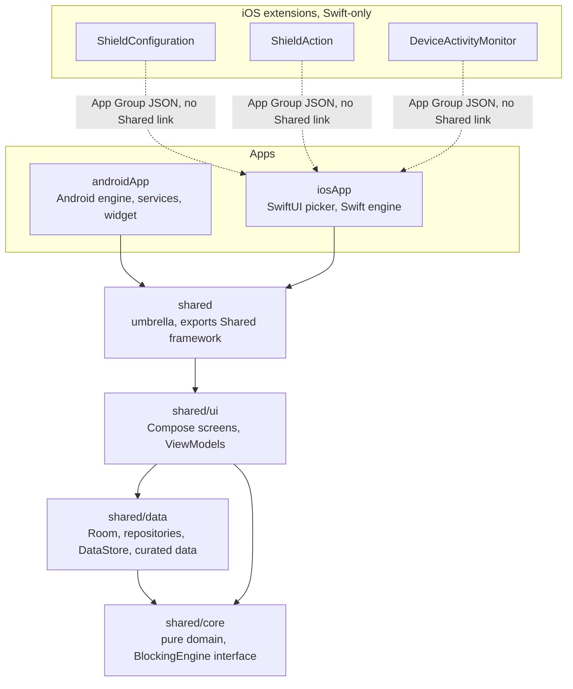
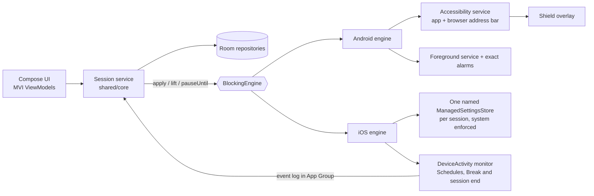

# Focal v1: reader's guide

A single-page tour of Focal v1 as built so far: what it does, how it is put together, what is known to be shaky and what is left. Terms follow [GLOSSARY.md](../GLOSSARY.md). Deeper material lives in [docs/specs/v1.md](specs/v1.md), [docs/adr/](adr/), [docs/android-blocking-engine.md](android-blocking-engine.md) and [docs/ios-blocking-engine.md](ios-blocking-engine.md); this page links rather than repeats.

## 1. Status at a glance

| Area | State |
| --- | --- |
| Product scope (75 user stories in the v1 spec) | Implemented, tickets T7 to T35 closed |
| Android blocking engine | Built; needs device measurement (time-to-Shield, flicker) |
| iOS blocking engine | Built; several behaviours unverified on a physical device |
| Store submission (T36) | Drafts written (`store-submission.md`, `store-listing.md`, `privacy-policy.md`); nothing submitted |
| Apple Family Controls (Distribution) entitlement (T2) | Not yet requested; gates TestFlight |
| Risk prototypes (T3 to T6) | Open, human-run on devices |

Size: about 176 Kotlin and Swift source files and 37 test files across four Gradle modules, an Android app and an iOS app with three Swift-only extensions.

## 2. What v1 does

Focal blocks distracting apps and websites during **Focus Sessions**, started by hand or by **Schedules**, on Android and iOS.

- **Onboarding and permissions**: explains what is asked and why before asking (Android accessibility disclosure, iOS Screen Time, notifications). Exact-alarm permission is asked only with the first Schedule. Missing permissions disable starting a session and show a fix-it banner.
- **Block Lists**: named sets of apps, App Categories and websites. Apps tab (installed-app picker on Android, Apple's picker on iOS); Websites tab with typed domains (normalised, subdomains included) and Suggested Websites. On Android, picking an app pre-selects its matching Suggested Websites, and App Categories cover apps installed later.
- **Focus Sessions**: Start screen with Block List, duration or end time and Strictness; several sessions run concurrently and a target stays blocked while any session blocks it.
  - **Normal**: end any time (Ended Early).
  - **Delayed**: 30 s Exit Countdown to end early, up to three 5-minute Breaks that resume automatically.
  - **Locked**: cannot be ended. Android: best-effort, revoking the accessibility service makes it Broken. iOS: Uninstall Protection.
  - **Stricter-only edits** of a running session: add targets, extend, raise Strictness; removals, shortening and lowering are refused or deferred (ADR 0007).
- **Schedules**: days, start/end (overnight allowed), Block List, Strictness, on/off switch. Start on time with Focal closed (Android exact alarms, iOS DeviceActivity monitor); missed starts catch up and still end at the scheduled end.
- **Shield**: shown instead of a blocked app or supported-browser website, names the session ("+N more"), time left, a motivational line, and only Close and Open Focal. On a blocked website, Close opens a new tab in the same browser.
- **Stats and Streaks**: focus time today and this week, outcome counts, current and longest Streak (a day counts with a Completed session of at least 15 minutes), Android Glance home-screen widget.
- **Android extras**: OEM battery guidance (Xiaomi, Samsung, Huawei, OnePlus) and a "Why did my session stop?" help entry.
- **Privacy**: all data on the device, no account, no backend, no analytics, no `INTERNET` permission on Android (ADR 0003).

## 3. Technical system

Kotlin Multiplatform with Compose Multiplatform UI. Each platform has its own blocking engine behind one shared interface.

| Concern | Choice |
| --- | --- |
| Language / UI | Kotlin 2.4, Compose Multiplatform 1.12, Material 3, JetBrains Navigation Compose |
| Presentation | Hand-rolled MVI: State / Intent / Effect (ADR 0011) |
| DI | Koin |
| Persistence | Room KMP + bundled SQLite, DataStore for preferences (ADR 0009) |
| Time and async | kotlinx-datetime, kotlinx-coroutines / Flow |
| iOS interchange | kotlinx-serialization, versioned JSON snapshot in an App Group (ADR 0008) |
| Android blocking | AccessibilityService, accessibility overlay, `specialUse` foreground service, exact alarms |
| iOS blocking | FamilyControls, ManagedSettings, DeviceActivity, Shield extensions |
| Widget | Jetpack Glance |
| Targets | Android API 26 to 37, iOS 17+ |

### Module layering (ADR 0010)



`core` has a plain `jvm()` target and no Compose, Room or platform imports, so the rules are tested on the JVM with a fake clock and a fake `BlockingEngine`.

### Runtime: how a session blocks



- **Android**: one accessibility service detects the foreground app and, in supported browsers, the committed address-bar hostname; it blocks the union of running sessions and draws the Shield as an accessibility overlay. A foreground service keeps sessions alive; one exact alarm wakes Focal for the next Schedule start or session end; state is restored after reboot or process death.
- **iOS**: the system enforces blocking from per-session `ManagedSettingsStore`s. Extensions make no domain decisions: they apply the app's snapshot and append event records that the session service ingests on launch (ADR 0008).

### Key decisions

| ADR | Decision |
| --- | --- |
| 0001 | Build Android and iOS in parallel |
| 0002 | Locked is best-effort on Android (Settings and uninstall are not blocked) |
| 0003 | On-device only, no backend in v1 |
| 0004 | Shared Compose UI, SwiftUI only for Apple's picker |
| 0005 | Android website blocking via accessibility, supported browsers only |
| 0006 | Concurrent Focus Sessions |
| 0007 | Running sessions can only get stricter |
| 0008 | iOS extensions are Swift-only, talking through a snapshot |
| 0009 | Room KMP for persistence |
| 0010 | Layered modules with an iOS umbrella |
| 0011 | Hand-rolled MVI |

## 4. Known issues and limits

**Android**
- Website blocking works only in supported browsers (Chrome family, Edge, Brave, Vivaldi, Kiwi, Samsung Internet, Firefox family, Opera, DuckDuckGo). Address-bar view IDs are browser internals and can change per release; Firefox's move to a Compose toolbar may drop its ID.
- Chrome's "query in omnibox" can show search terms instead of the URL, so `google.com` is not caught on results pages. In-app WebViews are not covered; Custom Tabs only where the toolbar ID is known.
- Locked is best-effort: uninstalling records no outcome and deletes local history; Settings is never Shielded (ADR 0002).
- OEM task killers can still stop sessions despite the foreground service; guidance is shown, not a guarantee.
- Without `SCHEDULE_EXACT_ALARM`, Schedules fall back to an inexact alarm that Doze may delay.
- Time-to-Shield and flicker on low-end devices are unmeasured (T6).

**iOS**
- Websites are blocked through Safari's content filter (typed domains cannot be `webDomains` tokens), so they show the system's "restricted" page rather than Focal's Shield. The picker also cannot hide its websites section.
- Open Focal from the Shield is a local notification the user taps, since a ShieldAction extension cannot open its app. Friction is unproven (T5).
- The Shield's time left is static ("About N min"), not a live countdown.
- A Schedule session started by the extension while Focal is in the foreground appears on Home only after Focal next returns to the foreground.
- Apple's caps are unconfirmed: about 50 named `ManagedSettingsStore`s (bounds concurrent sessions, T4) and about 20 DeviceActivity monitored activities. Three weekday-only Schedules already use 15; overflowing Schedules are dropped (and logged) with no UI warning yet, and only the launch backstop starts them.
- Unverified on a device: Uninstall Protection and revocation status, Breaks with Focal killed (the interval starts in the past to meet the 15-minute minimum, T3), repeating and overnight intervals, extension-registered session-end intervals.

**Both**
- iOS needs a physical device for Screen Time, and the Distribution entitlement is not yet granted (T2).
- Blocking engines and extensions have no automated tests; they are verified manually on devices (v1 spec, Testing Decisions).

## 5. What is coming

Still open for v1 (GitHub issues):
- #2 Request the Family Controls (Distribution) entitlement for the app and every extension bundle ID. Do this first; it gates TestFlight.
- #3 to #8 Device prototypes: iOS Break resumption under the 15-minute interval minimum, named-store cap, Open Focal from the Shield, Android time-to-Shield and flicker.
- #38 Store submission: fill placeholders, record the Play review video, submit to Play Console and App Store Connect.

Planned after v1 (spec "Out of Scope"): app limits and daily budgets, allow-list mode, per-app screen-time reports (v1.1); accounts, sync and backups; social features; paid tier; VPN-based strict web blocking; configurable Exit Countdown, Break length and count; richer Schedules (multiple windows, dates, holidays, skip today); a saved-websites library.

## 6. Points to improve

1. **Verify on devices before anything else.** The iOS risks and Android flicker numbers decide whether parts of the design hold; fallbacks are documented in the engine notes.
2. **Surface dropped Schedules on iOS** (activity cap) in the UI, and consider merging a Schedule's days into fewer activities.
3. **iOS website blocking UX**: let the picker choose web-domain tokens so websites get Focal's Shield instead of the system page.
4. **Browser coverage on Android**: a per-release device check for address-bar IDs, a fallback when the ID disappears, and a decision on Chrome's omnibox case.
5. **Automated coverage for the engines**: the Swift extensions and Android service logic are manual-only; contract tests for the snapshot and event log exist in core, but device-level checks (instrumented or UI tests) do not.
6. **Live Shield time on iOS** is limited by the system-rendered Shield; revisit if Apple allows more.
7. **Locked on Android** stays best-effort; if user feedback demands more, it needs a new ADR (device-owner mode and Settings blocking are explicitly out of scope today).
8. **Release hygiene**: Material 3 is on an alpha (`1.12.0-alpha03`); pin or move to stable before release. Add CI that runs the commands in AGENTS.md, since none is configured in the repo.

## 7. Reviewing this project

Suggested reading order: [GLOSSARY.md](../GLOSSARY.md), [v1 spec](specs/v1.md), ADRs 0002, 0006, 0007, 0008, then the two engine notes. Then follow one flow end to end: start a Focus Session in `shared/ui` (`start`), through the session service in `shared/core`, into `androidApp/.../blocking` or `iosApp/iosApp/IosBlockingEngine.swift`.

Run the tests:

```
./gradlew :shared:core:jvmTest
./gradlew :shared:ui:testAndroidHostTest
./gradlew :shared:iosSimulatorArm64Test :shared:testAndroidHostTest   # Koin wiring
./gradlew :shared:data:connectedAndroidDeviceTest                      # device or emulator
```

Build: `./gradlew :androidApp:assembleDebug`; iOS: open `iosApp/` in Xcode (physical device for blocking).
